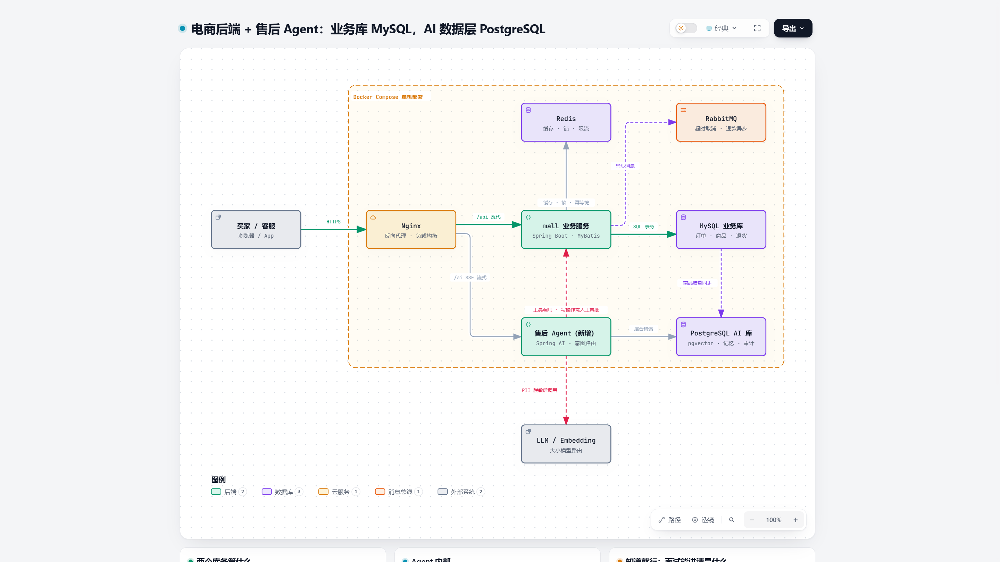
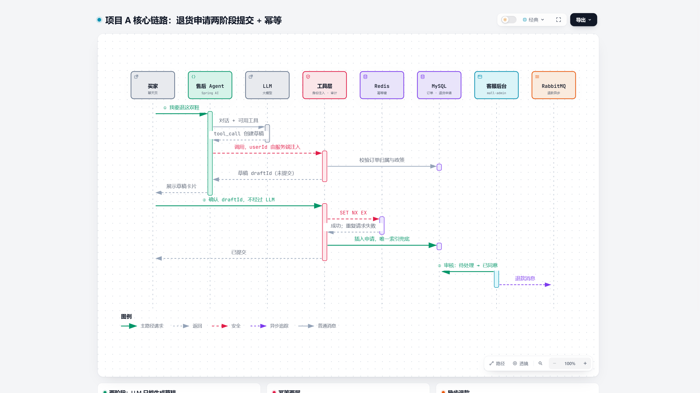
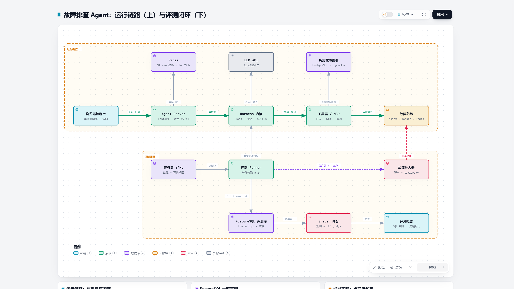

# 暑期实习准备（2026-10 → 2027-03）

目标：2027 年大厂暑期实习。简历上放两个能被深挖的 AI 方向项目；八股在项目期间同步准备；算法在项目冻结后集中冲刺。

## 两个项目，一条主线

| | 项目 A：电商智能售后 Agent | 项目 B：服务故障排查 Agent |
|---|---|---|
| 语言 | Java 17 · Spring Boot 3 · Spring AI | Python · FastAPI |
| 底座 | [macrozheng/mall](https://github.com/macrozheng/mall) 二次开发 | 自研 harness + web_foundation 通信层 |
| 数据层 | MySQL 业务库 + PostgreSQL/pgvector AI 库 | PostgreSQL/pgvector + Redis |
| AI 亮点 | 工具层安全、混合检索 RAG、意图与模型路由、语义缓存、护栏、跨库同步 | 自研内核、长期记忆、工具沙箱、评测与错误分析、消融实验 |
| 时间 | W10–W16（12/07–01/24） | W4–W9（10/26–12/06） |
| 方案 | [backend/PROJECT.md](backend/PROJECT.md) | [agent/PROJECT.md](agent/PROJECT.md) · [agent/EVAL.md](agent/EVAL.md) |

主线是**评测驱动的 Agent 开发**：项目 B 写的评测框架通过适配器接口同时评测两个 Agent，面试时两个项目能互相印证。

可交互版本（浏览器打开，支持缩放、聚焦、导出）：[backend-stack.html](diagrams/backend-stack/backend-stack.html)、[return-flow.html](diagrams/return-flow/return-flow.html)、[agent-eval.html](diagrams/agent-eval/agent-eval.html)。

## 文件导航

| 文件 | 内容 |
|---|---|
| [PLAN.md](PLAN.md) | **总计划**：每日分配、周六 Java 手感实验、阶段闸门、22 周时间线、每周验收、落后时怎么砍、打卡表 |
| [PRACTICES.md](PRACTICES.md) | 工作方式：14GB 内存怎么省、模型与成本、GitHub 门面、ADR 决策记录、AI 编程边界、指标、讲述稿 |
| [backend/TECH-MAP.md](backend/TECH-MAP.md) | 后端与 AI 名词地图：微服务/分布式/K8s 的关系、MySQL 与 PostgreSQL 怎么选、AI 应用技术栈、名词实物观察清单 |
| [backend/PROJECT.md](backend/PROJECT.md) | 项目 A：双库、四个功能模块、五项核心设计、时序图、逐周任务、指标卡、简历写法、面试追问 |
| [agent/PROJECT.md](agent/PROJECT.md) | 项目 B：技术栈、复用资产、长期记忆与防泄漏、故障目录、表结构、逐周任务、指标卡、简历写法、面试追问 |
| [agent/EVAL.md](agent/EVAL.md) | 评测从零做起：术语、七个步骤、适配器接口、SQL 报告、错误分析、消融、项目 A 如何复用 |
| [interview/PREP.md](interview/PREP.md) | 八股周表（Java 主线 + AI 主线）、W17 起的算法冲刺、项目深挖、投递节奏 |
| [resume/DRAFT.md](resume/DRAFT.md) | 简历骨架：两个投递版本、占位数字、自查清单 |
| [RESOURCES.md](RESOURCES.md) | 核实过的开源项目和文章，按用途分类 |
| [ALTERNATIVES.md](ALTERNATIVES.md) | 备选项目：Java 线 5 个、纯 Agent 线 6 个，含参考仓库、评测方法、风险、组合建议、换项目的截止时间、不推荐的方向 |
| `log/` | 周记、错题本、学习笔记 |

## 从今天开始（W1：10/05–10/11）

1. 项目（4 小时）：`E:\pi_north\agent-harness-course\practice` 让 `minimal_harness` 的测试变绿，从 `session.py` 开始
2. 八股（1 小时）：JavaGuide 的 Java 基础部分；AI 主线（30 分钟）：Token、上下文窗口、温度与采样
3. 周六（2 小时）：Java 手感实验 W1，Java 17 语法练手
4. 本周顺手做：按 PRACTICES.md 第一节配好 `.wslconfig`；在模型平台设好月度预算告警
5. 周日：在 `log/` 写第一篇周记，在 PLAN.md 打卡

## 相关仓库

| 仓库 | 作用 |
|---|---|
| `E:\agent_l` | Python 与 Agent 机制学习（learn-claude-code） |
| `E:\web_foundation` | 网络通信层：HTTP、SSE、WebSocket、Redis、Nginx。项目 B 的 Server 和靶场从这里复用 |
| `E:\pi_north` | Pi 源码与 harness 课程。项目 B 的内核从这里的练习开始 |
| `E:\incident-agent`（W4 新建） | 项目 B 代码 |
| `E:\mall-ai`（W1 fork，周六实验放在 `labs/`） | 项目 A 代码 |
